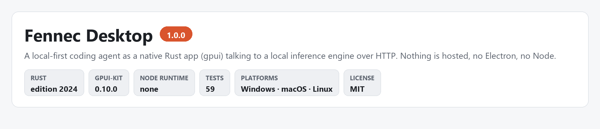

Fennec is a native Rust desktop app (egui/eframe) for the suite. The model, the agent loop,
the tools and the workspace discovery all run on this device; nothing is hosted, no account,
no API key, no cloud. It speaks to the two loopback services the suite already owns —
the [fennec-core](https://github.com/Liso7150/fennec-core) agent server and the
[Fennec](https://github.com/Liso7150/fennec) inference engine — and presents them in one
three-pane window.

The app was rewritten from Electron/React/TypeScript to native Rust. The previous JS/TS
source is preserved on the `legacy-electron` branch; the tracked source is Rust only.

## At a glance

| UI | Backend | Compaction | Tests | Platforms |
|---|---|---|---|---|
| native window, egui/eframe | agent server `127.0.0.1:8787`, engine SSE `127.0.0.1:8184` | `fennec-economy`, in-process | 15 | Windows, macOS, Linux |

## Architecture

```
fennec-desktop (this repo)          fennec-core/src (path dependency)
  src/main.rs    warm-dark UI   →    fennec-client   agent server + engine SSE clients
  src/events.rs  timeline model      +               suite / repos.json discovery, git context
  src/fonts.rs   font lookup     →    fennec-economy  context compaction
```

Nothing here re-implements a protocol. The HTTP/SSE contract, the workspace list and the
engine/model resolution come from `fennec-client`, which reads
[fennec-environment-setup/repos.json](https://github.com/Liso7150/fennec-environment-setup)
for the suite root and repo set — the same manifest the installer fetches from, so what the
selector shows is what `fennec update` keeps current.

## What it does

| Pane | Behavior |
|---|---|
| Left rail | Fennec brand, real repository selector (manifest `repos[]` that exist on disk), Coding / My Attention / New Task / Search, recent sessions from the agent server, repo · branch · changed footer |
| Center | Task header, structured timeline: streamed reasoning and answers, one card per tool call (category, title, Running / Complete / Warning / Failed, duration, arguments, expandable result), one card per gated call (risk, reason, the four answers), copyable code blocks, persistent composer, the loop's four controls (edits / commands / web / ask each) |
| Right | Environment (core, engine, model, vision, context window, tokens/s, outlets — live values), Subagents, Artifacts (files the run actually wrote), Research, context compaction |

> [!NOTE]
> Panels report what the backend actually exposes. With only the engine running the app is in
> direct chat mode, so the tool timeline is empty and says so; features with no backend
> registry are shown as unavailable instead of being faked — the composer's image, record and
> read-aloud buttons stay disabled, each tooltip naming the reason. For images the reason comes
> from the engine: `/health` answers with either a `vision` flag or an `input_modalities` list
> (the Fennec engine declares `vision: false`; a Colibri server lists `image`), and an engine
> that never answered is reported as this shell having no attachment path, because that is the
> blocker either way. The Environment pane mirrors the same three states in its Vision row.

## Build and run

The app path-depends on the sibling `fennec-core` checkout, so fetch the repos together first
(`fennec update`, or the installer's bootstrap), then:

```bash
cargo build --release --offline        # ./target/release/fennec-desktop(.exe)
cargo test  --release --offline        # 15 tests
```

The engine and the agent server start independently of the app; the Environment panel offers
`Start agent loop` when the server is not reachable. CI checks out `fennec-core` beside this
repo and runs the same two commands.

The layout is tested without a window. One test paints the whole interface through
`egui::Context::run_ui` and measures the triangles the painter would have received, at the
default and the minimum window size, so a pane that collapses fails the suite instead of only
looking wrong on somebody's screen.

## Which engine answers

Resolution order comes from `fennec-client`: the manifest's `engine_root` first, then the home
engine checkout, then a legacy Colibri checkout only as a last resort. An already-running
engine is attached to, never restarted.

## Security posture

Tool paths are jailed to the selected workspace; writing, shell and web each stay off until
the corresponding switch is set in the composer, and those flags are the agent loop's own, not
app-side decoration. A fourth switch (ask each) lifts the flags and puts every gated call to
you instead — the run waits on the answer, and a timeout or cancel is a rejection. No secret
is read, written or displayed. The UI has no web view, so there is no DOM and no script
injection surface. Both services are loopback-only.

## Credits

Engine: [Liso7150/fennec](https://github.com/Liso7150/fennec). Base idea:
[JustVugg/colibri](https://github.com/JustVugg/colibri) — device-tiered MoE inference.
Agent server and outlets: [Liso7150/fennec-core](https://github.com/Liso7150/fennec-core).
Part of the [Fennec suite](https://github.com/Liso7150/fennec-environment-setup).

## License

MIT — see [LICENSE](LICENSE).
